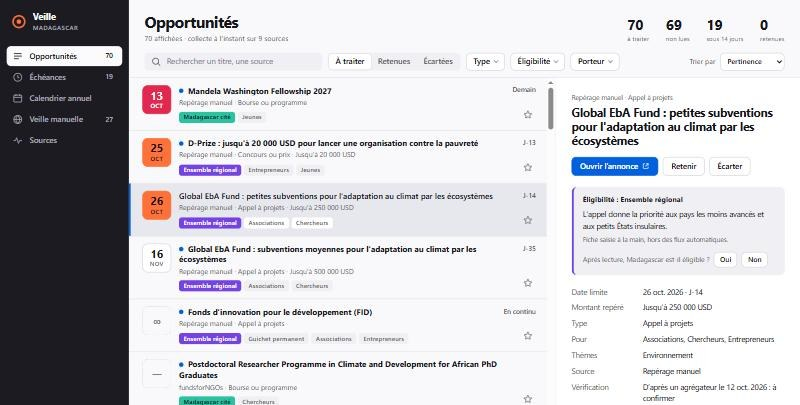
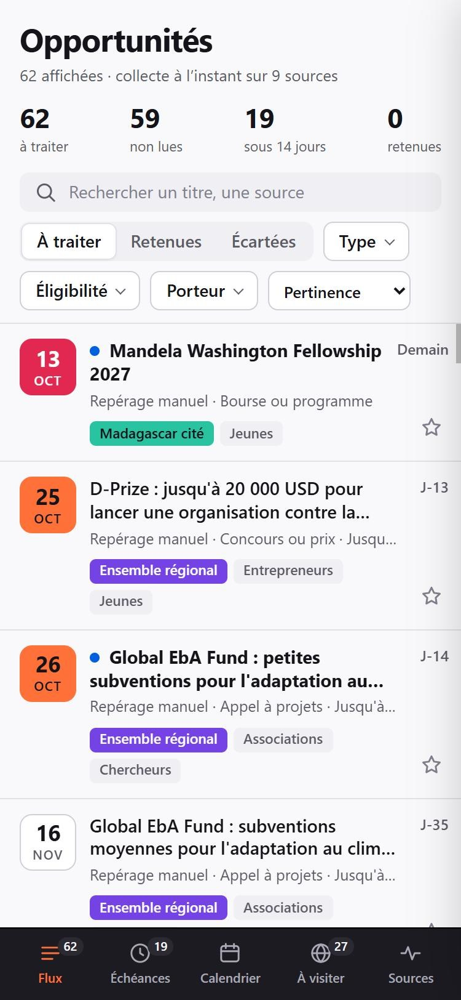
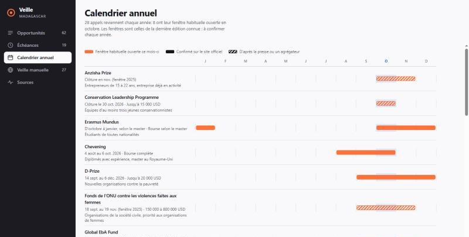
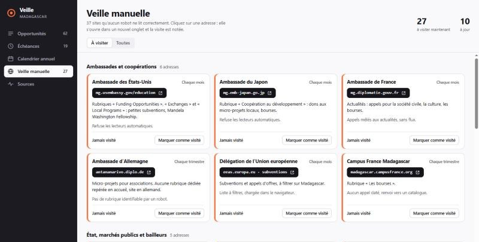
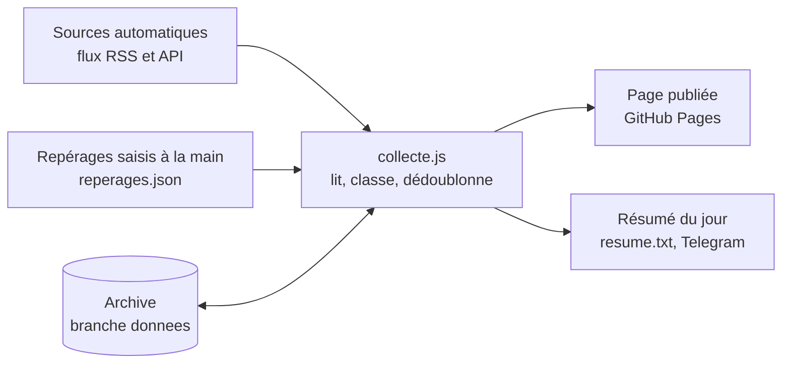

# Veille Madagascar

Outil de veille des appels à projets, concours, bourses et marchés ouverts aux porteurs de projets basés à Madagascar : jeunes, associations, entrepreneurs.

**Site en ligne : <https://mitsinjou-maker.github.io/veille-madagascar/>**

Il lit 8 sources (les agrégateurs toutes les deux heures, la presse et les marchés deux fois par jour), classe chaque annonce selon l'éligibilité de Madagascar, et tient à jour une liste de 38 sites à consulter soi-même. La dernière liste reste lisible sans connexion.



## Sommaire

- [Prise en main en dix minutes](#prise-en-main-en-dix-minutes)
- [Les cinq écrans](#les-cinq-écrans)
- [Comment l'outil fonctionne](#comment-loutil-fonctionne)
- [Les sites surveillés](#les-sites-surveillés)
- [La version en ligne](#la-version-en-ligne)
- [Utiliser l'outil sur son ordinateur](#utiliser-loutil-sur-son-ordinateur)
- [Personnaliser](#personnaliser)
- [Organisation du dépôt](#organisation-du-dépôt)
- [Dépannage](#dépannage)
- [Limites connues](#limites-connues)

## Prise en main en dix minutes

1. **Ouvrir le site.** Sur téléphone ou ordinateur : <https://mitsinjou-maker.github.io/veille-madagascar/>. Rien à installer, aucun compte.
2. **Lire la liste.** Chaque ligne est une opportunité. Les plus pertinentes sont en haut. La liste montre 100 annonces à la fois ; la suite arrive en défilant.
   - La tuile à gauche donne la date limite. Elle est rouge à trois jours ou moins, orange à quatorze jours ou moins. Un tiret signifie que la date n'a pas été trouvée, le signe ∞ que les candidatures sont acceptées en continu.
   - Le point bleu marque une annonce pas encore ouverte.
   - L'étiquette de couleur indique si Madagascar est éligible (voir [le tableau des étiquettes](#léligibilité)).
3. **Ouvrir une fiche.** Cliquer sur une ligne. La fiche cite la phrase qui justifie l'étiquette, puis la date limite, le montant repéré, le public visé et un extrait de l'annonce.
4. **Vérifier sur l'annonce d'origine.** Le bouton « Ouvrir l'annonce » mène au site source. Le classement est automatique : c'est l'annonce d'origine qui fait foi.
5. **Corriger si besoin.** Sous la phrase d'éligibilité, répondre Oui ou Non à « Madagascar est-il éligible ? ». L'étiquette change, et un Non retire l'annonce de la liste.
6. **Retenir ou écarter.** L'étoile garde une annonce dans « Retenues » ; « Écarter » la sort de la liste sans la supprimer.
7. **Surveiller les dates.** L'écran « Échéances » range les annonces par date limite. La pastille orange du menu compte les annonces retenues qui ferment sous trois jours.
8. **Faire la tournée manuelle.** L'écran « Veille manuelle » liste les sites qu'aucun robot ne lit. Cliquer sur une adresse l'ouvre dans un nouvel onglet et note la visite.
9. **Sur téléphone, épingler le site.** Dans le menu du navigateur, choisir « Ajouter à l'écran d'accueil » : l'outil s'ouvre ensuite comme une application.

Routine conseillée : cinq minutes par jour sur « Opportunités », un coup d'œil à « Échéances », et la tournée « Veille manuelle » une fois par semaine.



### Raccourcis clavier

| Touche | Action |
| --- | --- |
| `↑` `↓` ou `K` `J` | Annonce précédente ou suivante |
| `S` | Retenir l'annonce sélectionnée |
| `X` | Écarter l'annonce sélectionnée |
| `Entrée` | Ouvrir l'annonce d'origine |
| `/` | Aller au champ de recherche |
| `Échap` | Fermer la fiche ou le menu ouvert |

### Filtres

Trois menus affinent la liste : **Type**, **Éligibilité** et **Porteur**. Au départ, deux catégories sont masquées : les emplois, stages et missions de volontariat, et les annonces réservées à d'autres pays. Il suffit de les cocher pour les voir. Le menu « Trier par » classe par pertinence, par date limite ou par date de publication.

## Les cinq écrans

| Écran | Ce qu'on y trouve |
| --- | --- |
| **Opportunités** | Les annonces collectées, avec trois vues : à traiter, retenues, écartées. |
| **Échéances** | Les annonces datées, groupées : aujourd'hui et demain, cette semaine, sous 14 jours, sous 30 jours, plus tard. |
| **Calendrier annuel** | 28 appels qui reviennent chaque année, sur une frise de douze mois, et les guichets ouverts en continu. |
| **Veille manuelle** | 38 sites à ouvrir soi-même, avec leur rythme de visite et la date de dernière visite. |
| **Sources** | L'état de chaque source automatique et le résumé de la dernière collecte. |



Sur la frise, une barre orange signale une fenêtre habituellement ouverte ce mois-ci. Une barre pleine vient du site officiel ; une barre hachurée vient de la presse ou d'un agrégateur et reste à confirmer.



## Comment l'outil fonctionne



Toutes les deux heures, GitHub Actions exécute `collecte.js`. Le script :

1. **interroge** chaque source, avec un délai maximal de 30 secondes. Une source qui répond « rien de neuf » n'est pas retéléchargée ;
2. **classe** chaque annonce : type, éligibilité, porteurs visés, thèmes, date limite, montant ;
3. **fusionne** le résultat avec l'archive des collectes précédentes ;
4. **dédoublonne** les annonces vues sur plusieurs sources ;
5. **écrit** l'archive, le résumé du jour, puis la page est republiée.

Aucune intelligence artificielle n'intervient : le classement repose sur des listes de mots-clés en français, en anglais et en malgache. Il est rapide et gratuit, mais il se trompe parfois.

### L'éligibilité

| Étiquette | Signification |
| --- | --- |
| **Madagascar cité** | Madagascar est nommé dans l'annonce, ou figure dans la liste de pays donnée par la source. |
| **Ensemble régional** | L'annonce vise un ensemble qui inclut Madagascar : Afrique, Afrique subsaharienne, pays les moins avancés, pays ACP, espace francophone, océan Indien, SADC, COMESA, pays en développement. |
| **Ouvert au monde** | L'annonce se dit ouverte à tous les pays. |
| **À vérifier** | Aucune indication de pays, ou une zone ambiguë comme « Afrique australe ». |
| **Autre zone ciblée** | L'annonce vise un autre pays ou une autre région. Masquée par défaut. |

Les règles s'appliquent dans cet ordre ; la première qui correspond l'emporte.

1. Un article de la presse malgache ou un marché de la Banque mondiale à Madagascar est classé « Madagascar cité ».
2. Si la source donne une liste de pays (fundsforNGOs), tout dépend de la présence de Madagascar dans cette liste.
3. Si le mot Madagascar, malgache ou malagasy apparaît, l'annonce est classée « Madagascar cité ».
4. Si l'adresse de l'annonce range celle-ci dans un autre pays (Les Opportunités), elle est classée « Autre zone », sauf mission à distance.
5. Si le titre ou le début du texte nomme un autre pays africain ou une autre région, ou si le titre se termine par un pays lointain, elle est classée « Autre zone ».
6. Si le titre vise l'Afrique australe ou l'Afrique de l'Est, elle est classée « À vérifier ».
7. Si la source classe l'annonce par continent, la présence de l'Afrique décide.
8. Si le texte cite un ensemble régional qui inclut Madagascar, elle est classée « Ensemble régional ».
9. Si le texte dit « worldwide », « all countries » ou équivalent, elle est classée « Ouvert au monde ».
10. Si la source elle-même s'adresse aux candidats africains (Opportunities for Africans), elle est classée « Ensemble régional ».
11. Sinon, elle est classée « À vérifier ».

### Le type

Le titre est comparé à des mots-clés, dans cet ordre : emploi, marché ou consultance, concours ou prix, bourse, appel à projets, programme. Si le titre ne dit rien, les catégories de la source puis le début du texte sont examinés.

### La date limite et le montant

Une date n'est retenue que si elle suit un mot comme « deadline », « closing date », « date limite » ou « jusqu'au ». Sinon elle reste inconnue : l'outil ne devine pas. Le montant affiché est le premier montant écrit dans l'annonce ; ce n'est pas toujours celui de la subvention.

### Les doublons et la conservation

- Deux annonces de sources différentes sont fusionnées quand leurs titres partagent l'essentiel de leurs mots. La fiche indique alors « Aussi vu sur ».
- Une annonce réservée à un autre pays, masquée par défaut, n'est gardée que 7 jours.
- Une annonce datée est supprimée 45 jours après sa date limite.
- Une annonce sans date est supprimée 75 jours après sa publication.
- Une annonce retenue n'est jamais supprimée de l'archive locale.
- L'archive garde au plus 1 200 annonces, les mieux notées d'abord.

### Les garde-fous

- **Sources bornées.** Chaque réponse est limitée à 5 Mo, chaque flux à 200 articles et chaque article à 20 000 caractères. Un flux défaillant ou hostile ne bloque pas les autres.
- **Écriture en deux temps.** L'archive et l'état sont écrits dans un fichier temporaire, puis renommés : une coupure de courant pendant l'écriture laisse l'ancien fichier intact.
- **Copie de la veille.** À la première écriture de chaque jour, l'état précédent est gardé dans `opportunites.sauvegarde.json` et `etat.sauvegarde.json`. Si le fichier principal est illisible, l'outil repart de cette copie.
- **Chute anormale refusée.** Si une collecte ferait perdre plus de la moitié des annonces de l'archive, elle n'est pas écrite et la collecte s'arrête en erreur.
- **Données assainies à l'affichage.** La page ramène tout ce qu'elle lit à des valeurs connues ou à du texte borné avant de l'afficher.
- **Politique de sécurité de la page.** Seuls les fichiers du site peuvent être chargés ou exécutés : un script glissé dans la page ou venu d'ailleurs est bloqué par le navigateur.
- **Tests avant publication.** À chaque exécution, la syntaxe de chaque fichier est vérifiée et 25 tests rejouent le classement, la lecture des flux, l'écriture des fichiers et le serveur local. Un échec arrête tout avant la collecte.

### Le rythme des sources

- **Par défaut**, une source est interrogée à chaque collecte, soit toutes les deux heures en ligne.
- **Rythme lent.** Midi Madagasikara et la Banque mondiale portent `"intervalleHeures": 12` dans `config.json` : ils ne sont relus que deux fois par jour. Une lecture en échec est retentée à la collecte suivante.
- **Rien de neuf.** L'outil présente à chaque source ce qu'elle avait annoncé la fois précédente. Si rien n'a changé, elle répond d'une ligne et l'écran Sources affiche « Lue, sans changement ». Toutes les sources ne jouent pas ce jeu : certaines renvoient leur flux entier à chaque fois.
- **Après un changement de règles.** Les annonces déjà archivées ne sont reclassées que si leur source est relue en entier. C'est automatique quand `config.json` change ; après une modification des règles dans `collecte.js`, augmenter la constante `REGLES`.

## Les sites surveillés

Trois listes, toutes modifiables (voir [Personnaliser](#personnaliser)). Elles ont été vérifiées le 12 octobre 2026.

### Sources lues automatiquement

| Source | Ce qu’elle apporte | Accès |
| --- | --- | --- |
| [Opportunities for Africans](https://www.opportunitiesforafricans.com/feed/) | Bourses, fellowships et concours pour candidats africains | Flux RSS |
| [Opportunity Desk](https://opportunitydesk.org/feed/) | Prix, subventions et programmes pour jeunes, portée mondiale | Flux RSS |
| [Opportunities for Youth](https://opportunitiesforyouth.org/feed/) | Fellowships, bourses et concours, portée mondiale | Flux RSS ; refuse parfois les serveurs de GitHub |
| [Terra Viva Grants](https://www.terravivagrants.org/feed/) | Environnement, agriculture, climat ; pays éligibles précisés | Flux RSS |
| [fundsforNGOs](https://www2.fundsforngos.org/feed/) | Appels pour ONG du monde entier, avec la liste des pays visés ; très abondant | Flux RSS |
| [Les Opportunités](https://www.lesopportunites.com/feed/) | Annonces en français, dont Madagascar : stages, volontariat, consultances | Flux RSS |
| [Midi Madagasikara](https://midi-madagasikara.mg/feed/) | Presse malgache : seuls les articles parlant d’appels, de concours ou de bourses sont gardés | Flux RSS |
| [Banque mondiale, marchés](https://search.worldbank.org/api/v2/procnotices?format=json&project_ctry_name_exact=Madagascar&rows=40&srt=submission_date&order=desc) | Appels d’offres et manifestations d’intérêt des projets financés à Madagascar | API ouverte |

La collecte se présente aux sites sous le nom `VeilleMadagascar/0.1` et ne lit que les flux que ces sites publient pour cet usage.

### Sites de la veille manuelle

Ces sites refusent les robots, n'ont pas de flux, ou ne publient qu'un appel par an. L'outil ne les lit pas : il rappelle quand les ouvrir.

<details>
<summary><b>Ambassades et coopérations</b> — 10 adresses</summary>

| Site | Adresse à ouvrir | Ce qu’on y cherche | Quand y aller |
| --- | --- | --- | --- |
| Ambassade des États-Unis | [mg.usembassy.gov/education](https://mg.usembassy.gov/education/) | Rubriques « Funding Opportunities », « Exchanges » et « Local Programs » : petites subventions, Mandela Washington Fellowship. | Chaque mois |
| Ambassade du Japon | [mg.emb-japan.go.jp](https://www.mg.emb-japan.go.jp/itprtop_fr/index.html) | Rubrique « Coopération au développement » : dons aux micro-projets locaux, bourses. | Chaque mois |
| Ambassade de France | [mg.diplomatie.gouv.fr](https://mg.diplomatie.gouv.fr/) | Actualités : appels pour la société civile, la culture, les bourses. | Chaque mois |
| Ambassade d'Allemagne | [antananarivo.diplo.de](https://antananarivo.diplo.de/) | Micro-projets pour associations. Aucune rubrique dédiée repérée en accueil, site en allemand. | Chaque trimestre |
| Ambassade britannique | [gov.uk/world/organisations/british-embassy-antananarivo](https://www.gov.uk/world/organisations/british-embassy-antananarivo) | Annonces des bourses Chevening. La page n'affiche pas d'appel. | En août |
| Haut-commissariat d'Australie | [mauritius.embassy.gov.au](https://mauritius.embassy.gov.au/plut/DAPFY2026-2027.html) | Ouverture de la prochaine session du Direct Aid Program. | De juillet à septembre |
| Canada, Fonds d'initiatives locales | [international.gc.ca · FCIL](https://www.international.gc.ca/world-monde/funding-financement/cfli-fcil/index.aspx?lang=fra) | Ligne « Madagascar » dans la liste des appels. | En mai et juin |
| Délégation de l'Union européenne | [eeas.europa.eu · subventions](https://www.eeas.europa.eu/eeas/subventions_fr?s=106) | Subventions et appels d'offres, à filtrer sur Madagascar. | Chaque mois |
| JICA Madagascar | [jica.go.jp · Madagascar](https://www.jica.go.jp/french/overseas/madagascar/index.html) | Bourses ABE Initiative, concours Mizunami. | En avril et mai |
| Campus France Madagascar | [madagascar.campusfrance.org](https://www.madagascar.campusfrance.org/) | Rubrique « Les bourses ». | Chaque trimestre |

</details>

<details>
<summary><b>État, marchés publics et bailleurs</b> — 5 adresses</summary>

| Site | Adresse à ouvrir | Ce qu’on y cherche | Quand y aller |
| --- | --- | --- | --- |
| ARMP, marchés publics | [app.armp.mg](https://app.armp.mg/) | Portails « Secteur privé » et « Société civile » : avis d'appels d'offres. | Chaque semaine |
| PNUD Madagascar | [undp.org/fr/madagascar](https://www.undp.org/fr/madagascar) | Appels à propositions, micro-financements du FEM, achats. | Chaque mois |
| UNGM, achats des Nations unies | [ungm.org/Public/Notice](https://www.ungm.org/Public/Notice) | Recherche avec le filtre de pays « Madagascar ». | Chaque semaine |
| Banque africaine de développement | [afdb.org · procurement](https://www.afdb.org/en/projects-and-operations/procurement) | Avis de marchés des projets à Madagascar. | Chaque mois |
| L'Express, annonces | [annonces.lexpress.mg/c/appels-offres](https://annonces.lexpress.mg/c/appels-offres) | Appels d'offres locaux. | Chaque mois |

</details>

<details>
<summary><b>Fonds, bourses et concours</b> — 16 adresses</summary>

| Site | Adresse à ouvrir | Ce qu’on y cherche | Quand y aller |
| --- | --- | --- | --- |
| CEPF | [cepf.net · open calls](https://www.cepf.net/grants/open-calls-for-proposals) | Appel « Madagascar and Indian Ocean Islands ». | Chaque mois |
| Fondation Tany Meva | [tanymeva.org](https://tanymeva.org/) | Appels à projets communautaires. | Chaque mois |
| FAPBM | [fapbm.org](https://www.fapbm.org/) | Rubriques « Appel d'offres » et « Subventions annuelles ». | Chaque trimestre |
| Global EbA Fund | [globalebafund.org](https://globalebafund.org/) | Petites et moyennes subventions d'adaptation au climat. | De septembre à novembre |
| Conservation Leadership Programme | [conservationleadershipprogramme.org](https://conservationleadershipprogramme.org/) | Appel annuel des « Team Awards ». | En septembre et octobre |
| Rufford Foundation | [rufford.org](https://www.rufford.org/) | Petites subventions pour jeunes conservationnistes. | Chaque trimestre |
| AUF | [auf.org/appels-a-propositions](https://www.auf.org/appels-a-propositions/) | Appels à candidatures, notamment de la direction Afrique australe et océan Indien. | Chaque mois |
| Erasmus Mundus | [eacea.ec.europa.eu · catalogue](https://www.eacea.ec.europa.eu/scholarships/erasmus-mundus-catalogue_en) | Masters avec bourse ; la candidature se fait sur le site de chaque master. | D'octobre à janvier |
| Chevening | [chevening.org/scholarship/madagascar](https://www.chevening.org/scholarship/madagascar/) | Ouverture des candidatures ; abonnement aux alertes. | En août |
| Mandela Washington Fellowship | [mandelawashingtonfellowship.org/apply](https://www.mandelawashingtonfellowship.org/apply/) | Ouverture des candidatures. | En septembre |
| Tony Elumelu Foundation | [tonyelumelufoundation.org](https://www.tonyelumelufoundation.org/) | Annonce du programme ; la candidature se fait sur TEFConnect. | En janvier |
| Prix Orange de l'entrepreneur social | [poesam.orange.com](https://poesam.orange.com/fr) | Plateforme de candidature. | En avril |
| Prix Pierre Castel | [fonds-pierre-castel.org](https://www.fonds-pierre-castel.org/prix-pierre-castel/prix-pierre-castel-2026/) | Ouverture de l'édition suivante. | En avril |
| Trophée du Jeune Entrepreneur BNI | [bni.mg/TJE2026](https://www.bni.mg/TJE2026) | Règlement et retrait des dossiers. | En juin |
| Fonds des Nations unies pour la démocratie | [un.org/democracyfund](https://www.un.org/democracyfund/apply-for-funding) | Fenêtre annuelle ; la page affichait encore celle de février 2025. | En janvier |
| Fonds de l'ONU contre les violences faites aux femmes | [untf.unwomen.org](https://untf.unwomen.org/en/grant-giving/call-for-proposals) | Appel annuel. | De septembre à novembre |

</details>

<details>
<summary><b>Relais locaux</b> — 4 adresses</summary>

| Site | Adresse à ouvrir | Ce qu’on y cherche | Quand y aller |
| --- | --- | --- | --- |
| Zafy Tody, incubateur | [zafytody.mg](https://www.zafytody.mg/) | Programmes SEED et RISE, cohortes Miary Digital. | Chaque trimestre |
| Institut français de Madagascar | [institutfrancais-madagascar.com](https://www.institutfrancais-madagascar.com/) | Agenda culturel, appels aux artistes. | Chaque mois |
| Capmad, média économique | [capmad.com](https://www.capmad.com/) | Articles relayant concours et appels pour entrepreneurs. | Chaque semaine |
| Newsmada, quotidien | [newsmada.com](https://newsmada.com/) | Articles annonçant concours, appels à projets et bourses à Madagascar : Prix Orange, Prix Pierre Castel, ambassades. Chercher « appel », « concours », « candidatures ». | Chaque semaine |

</details>

<details>
<summary><b>Agrégateurs sans flux</b> — 3 adresses</summary>

| Site | Adresse à ouvrir | Ce qu’on y cherche | Quand y aller |
| --- | --- | --- | --- |
| fundsforNGOs, étiquette Madagascar | [www2.fundsforngos.org/tag/madagascar](https://www2.fundsforngos.org/tag/madagascar/) | Toutes les annonces où Madagascar est cité comme pays éligible. | Chaque semaine |
| Youth Opportunities | [youthop.com](https://www.youthop.com/) | Sections « Latest Additions » et « Deadline Approaching ». | Chaque semaine |
| VC4A, programmes | [vc4a.com/programs](https://vc4a.com/programs/) | Concours et accélérateurs pour startups africaines ; chercher « Madagascar ». | Chaque semaine |

</details>

<details>
<summary><b>Structures sans adresse fiable</b> — 5, à suivre sur les réseaux sociaux ou par la presse</summary>

| Structure | Constat | Comment la suivre |
| --- | --- | --- |
| NextA, incubateur du groupe Axian | L'adresse nexta.mg ne répond pas. Le concours Mizunami 2026 s'est tenu du 30 avril au 29 mai, d'après la presse. | Pages Facebook et LinkedIn de NextA ; presse en avril. |
| Orange Digital Center Madagascar | L'adresse testée ne s'ouvre pas. | Pages d'Orange Madagascar sur les réseaux sociaux. |
| OMAPI | L'adresse omapi.mg ne répond pas. | Presse en février-mars pour le concours national d'innovation. |
| Alliance française d'Antananarivo | L'adresse alliancefr.mg est introuvable. | Page Facebook ; presse en mars pour la bourse à la création. |
| Goethe-Zentrum, Cercle Germano-Malagasy | L'adresse goethe-tana.de, citée par des annuaires, affiche aujourd'hui un site de jeux d'argent sans rapport. Ne pas l'utiliser. | Page Facebook du centre ; presse. |

</details>

### Appels du calendrier annuel

<details>
<summary><b>Voir les 28 appels</b>, dans l’ordre de l’année</summary>

| Appel | Fenêtre de la dernière édition connue | Pour qui | Montant | Source de l’information |
| --- | --- | --- | --- | --- |
| [Tony Elumelu Foundation](https://www.tonyelumelufoundation.org/) | 1er janv. au 1er mars 2026 | Jeunes fondateurs des 54 pays africains | 5 000 USD | Site officiel |
| [Fonds des Nations unies pour la démocratie](https://www.un.org/democracyfund/apply-for-funding) | 1er au 28 févr. (fenêtre 2025) | Organisations de la société civile | 100 000 à 200 000 USD | Presse ou agrégateur, à confirmer |
| [Fonds La Francophonie avec Elles](https://www.francophonie.org/appels-projets-candidatures-initiatives-1111) | 25 févr. au 26 avr. 2026 | Organisations actives depuis deux ans, projets en faveur des femmes | 15 000 à 100 000 euros | Presse ou agrégateur, à confirmer |
| GSMA Innovation Fund | Clôtures en avril et juin 2026 | Entreprises de moins de 250 salariés | Jusqu'à 200 000 à 300 000 GBP | Presse ou agrégateur, à confirmer |
| Interreg Canal du Mozambique | 6 févr. au 3 avr. 2026 | Acteurs de la coopération régionale avec Mayotte et La Réunion | Non trouvé | Presse ou agrégateur, à confirmer |
| Africa's Business Heroes | Clôture le 28 avr. 2026 | Entreprises africaines avec trois ans de revenus | 1,5 million USD pour dix finalistes | Presse ou agrégateur, à confirmer |
| Alliance française d'Antananarivo, bourse à la création | Clôture le 17 avr. 2026 | Groupes de musique malgaches | 8 millions d'ariary | Presse ou agrégateur, à confirmer |
| Cartier Women's Initiative | 26 mars au 16 juin 2026 | Entreprises dirigées par des femmes ; dossier en anglais | Jusqu'à 100 000 USD | Presse ou agrégateur, à confirmer |
| Concours national d'innovation de l'OMAPI | 5 mars au 29 mai 2026 | Étudiants, chercheurs, startups et porteurs de projets à Madagascar | Non trouvé | Presse ou agrégateur, à confirmer |
| Fonds international pour la diversité culturelle (UNESCO) | 23 mars au 6 mai 2026 | ONG et institutions publiques, projets culturels | Jusqu'à 100 000 USD | Presse ou agrégateur, à confirmer |
| Concours Mizunami (NextA) | 30 avr. au 29 mai 2026 | Entrepreneurs de 18 à 40 ans, entreprise de moins de cinq ans | 30 millions d'ariary | Presse ou agrégateur, à confirmer |
| [Prix Orange de l'entrepreneur social](https://poesam.orange.com/fr) | Clôture le 10 mai 2026 | Projets à impact social ou environnemental, édition nationale à Madagascar | Jusqu'à 25 000 euros | Presse ou agrégateur, à confirmer |
| [Prix Pierre Castel](https://www.fonds-pierre-castel.org/prix-pierre-castel/prix-pierre-castel-2026/) | 1er avr. au 30 mai 2026 | Entrepreneurs de 18 à 45 ans, entreprise d'au moins deux ans | 25 000 euros au lauréat national | Presse ou agrégateur, à confirmer |
| [CEPF, grandes subventions](https://www.cepf.net/grants/open-calls-for-proposals) | Clôture le 7 juil. 2026 | Société civile, conservation de la biodiversité à Madagascar | Plus de 50 000 USD | Presse ou agrégateur, à confirmer |
| [Fonds canadien d'initiatives locales](https://www.international.gc.ca/world-monde/funding-financement/cfli-fcil/index.aspx?lang=fra) | Clôture le 3 juil. 2026 | ONG locales, groupes communautaires, universités | 31 000 CAD en moyenne | Site officiel |
| GoGettaz Agripreneur Prize | Clôture le 28 juin 2026 | 18 à 35 ans, entreprise agroalimentaire enregistrée | 50 000 USD | Presse ou agrégateur, à confirmer |
| [Trophée du Jeune Entrepreneur BNI](https://www.bni.mg/TJE2026) | 29 juin au 2 sept. 2026 | Entrepreneurs de moins de 45 ans, entreprise d'au moins un an | Non trouvé | Presse ou agrégateur, à confirmer |
| Africa Prize for Engineering Innovation | 13 juil. au 8 sept. 2026 | Innovateurs d'Afrique subsaharienne | 50 000 GBP au lauréat | Presse ou agrégateur, à confirmer |
| [Direct Aid Program australien](https://mauritius.embassy.gov.au/plut/DAPFY2026-2027.html) | Clôture le 20 sept. 2026 | ONG et groupes communautaires enregistrés | Jusqu'à 60 000 AUD | Site officiel |
| [Chevening](https://www.chevening.org/scholarship/madagascar/) | 4 août au 6 oct. 2026 | Diplômés avec expérience, master au Royaume-Uni | Bourse complète | Site officiel |
| [D-Prize](https://www.d-prize.org/) | 14 sept. au 6 déc. 2026 | Nouvelles organisations contre la pauvreté | Jusqu'à 20 000 USD | Site officiel |
| [Fonds de l'ONU contre les violences faites aux femmes](https://untf.unwomen.org/en/grant-giving/call-for-proposals) | 18 sept. au 19 nov. (fenêtre 2025) | Organisations de la société civile, priorité aux organisations de femmes | 150 000 à 800 000 USD | Presse ou agrégateur, à confirmer |
| [Global EbA Fund](https://globalebafund.org/) | 28 sept. au 16 nov. 2026 | ONG, organisations communautaires, universités, entreprises | Jusqu'à 250 000 ou 500 000 USD | Presse ou agrégateur, à confirmer |
| [Mandela Washington Fellowship](https://www.mandelawashingtonfellowship.org/apply/) | 22 sept. au 13 oct. 2026 | Jeunes leaders de 25 à 35 ans, anglais exigé | Séjour pris en charge | Site officiel |
| Anzisha Prize | Clôture en nov. (fenêtre 2025) | Entrepreneurs de 15 à 22 ans, entreprise déjà en activité | Non trouvé | Presse ou agrégateur, à confirmer |
| [Conservation Leadership Programme](https://conservationleadershipprogramme.org/) | Clôture le 30 oct. 2026 | Équipes d'au moins trois jeunes conservationnistes | Jusqu'à 15 000 USD | Presse ou agrégateur, à confirmer |
| [Erasmus Mundus](https://www.eacea.ec.europa.eu/scholarships/erasmus-mundus-catalogue_en) | D'octobre à janvier, selon le master | Étudiants de toutes nationalités | Bourse selon le master | Site officiel |
| Prince Claus Seed Awards | Clôture le 8 janv. 2026 | Artistes et acteurs culturels en début de carrière | 5 000 euros | Presse ou agrégateur, à confirmer |

</details>

## La version en ligne

| Élément | Où |
| --- | --- |
| Page publique | <https://mitsinjou-maker.github.io/veille-madagascar/> |
| Flux de collecte | `.github/workflows/collecte.yml`, en trois tâches |
| Archive des annonces | branche `donnees` du dépôt |
| Historique des exécutions | onglet [Actions](https://github.com/mitsinjou-maker/veille-madagascar/actions) |

- **Rythme.** La collecte part toutes les deux heures, à la minute 23. GitHub peut la retarder aux heures chargées.
- **Trois tâches aux droits séparés.** La première vérifie le code, collecte et assemble le site ; elle lit du contenu venu de sites tiers et n'a aucun droit d'écriture. La deuxième dépose l'archive sur la branche `donnees`. La troisième publie la page. Les actions GitHub utilisées sont désignées par l'empreinte d'un commit.
- **Lecture hors connexion.** Après une première visite, le navigateur garde la page et la dernière liste. Sans réseau, ou sur une connexion qui met plus de quatre secondes à répondre, c'est cette copie qui s'affiche ; la date de la dernière collecte indique son âge.
- **Lancer une collecte à la main.** Onglet Actions, flux « Collecte et mise en ligne », bouton « Run workflow ».
- **Changer le rythme.** Modifier la ligne `cron` du flux. L'heure y est exprimée en temps universel ; Madagascar a trois heures d'avance.
- **Mémoire de l'utilisateur.** Les annonces retenues, écartées, lues et les visites sont enregistrées dans le navigateur de chaque appareil. Elles ne se synchronisent pas entre téléphone et ordinateur, et disparaissent si l'on efface les données du navigateur.
- **Visibilité.** La page est publique. Elle demande aux moteurs de recherche de ne pas l'indexer, mais toute personne qui a le lien peut la lire.

### Ce qui se passe quand on modifie le code

Tout changement envoyé sur la branche `main` relance une collecte et republie la page en quelques minutes.

| Fichier modifié | Effet en ligne |
| --- | --- |
| `interface/` | Visible par tous dès la republication. |
| `collecte.js`, `config.json` | Appliqué à la collecte suivante. Les annonces déjà archivées et sorties des flux gardent leur ancien classement. |
| `donnees/reperages.json`, `calendrier.json`, `sources-manuelles.json` | Affiché après la republication. |
| Fichiers `.md` et dossier `docs/` seuls | Aucun : la documentation ne relance pas de collecte. |

Une erreur de syntaxe, un test en échec ou une erreur du collecteur arrêtent l'exécution avant la publication : la page reste sur sa dernière version. Une erreur d'affichage qui n'est ni une faute de syntaxe ni un cas couvert par les tests peut encore partir en ligne. Il vaut donc mieux essayer en local avant d'envoyer.

### Recevoir le résumé sur Telegram

1. Créer un bot avec @BotFather sur Telegram et noter son jeton.
2. Écrire un message au bot, puis relever l'identifiant de la conversation.
3. Dans le dépôt : Settings, Secrets and variables, Actions. Ajouter deux secrets, `TELEGRAM_JETON` et `TELEGRAM_DESTINATAIRE`.

Un message part seulement quand une collecte trouve du nouveau. Cet envoi est écrit mais n'a pas encore été essayé.

## Utiliser l'outil sur son ordinateur

Il faut [Node.js](https://nodejs.org) 18 ou plus récent. Aucune autre installation.

Sous Windows, double-cliquer sur `Lancer la veille.bat`. Sinon :

```bash
node serveur.js --ouvrir
```

Le navigateur s'ouvre sur `http://localhost:4173`. Laisser la fenêtre de commande ouverte ; la fermer arrête l'outil. Pour un autre port, ajouter `--port=4180`.

Le serveur local ne répond qu'aux adresses `localhost` et `127.0.0.1` de cet ordinateur.

En local, le bouton « Actualiser » relance la collecte, au plus une fois toutes les 15 minutes pour ménager les sites. La mémoire de l'utilisateur est enregistrée dans `donnees/etat.json`.

Pour lancer les tests, qui travaillent dans un dossier temporaire et sans réseau :

```bash
node --test tests/*.test.js
```

Pour collecter sans ouvrir l'interface :

```bash
node collecte.js
```

## Personnaliser

### Le profil

Dans `config.json` :

```json
"profil": {
  "porteurs": ["jeunes", "associations", "entrepreneurs"],
  "themes": [],
  "motsExclus": []
}
```

- `porteurs` : parmi `jeunes`, `associations`, `entrepreneurs`, `femmes`, `chercheurs`, `artistes`. Les annonces qui les visent remontent dans la liste.
- `themes` : parmi `agriculture`, `environnement`, `numerique`, `sante`, `education`, `energie`, `gouvernance`, `eau`.
- `motsExclus` : toute annonce contenant l'un de ces mots est ignorée.

### Ajouter une source automatique

Ajouter une ligne à `sources` dans `config.json`. Il faut l'adresse d'un flux RSS.

```json
{ "id": "exemple", "nom": "Nom affiché", "type": "rss", "url": "https://exemple.org/feed/" }
```

| Option | Effet |
| --- | --- |
| `"typeDefaut": "appel"` | Type attribué quand le titre ne permet pas de trancher. |
| `"typeForce": "marche"` | Type imposé à toutes les annonces de la source. |
| `"zone": "afrique"` | Source destinée aux candidats africains : classement « Ensemble régional » par défaut. |
| `"presse": true` | Journal généraliste : seuls les articles parlant d'appels, de concours ou de bourses sont gardés. |
| `"paysDansTitre": true` | Un pays lointain dans le titre vaut restriction. |
| `"intervalleHeures": 12` | Ne relit la source que toutes les 12 heures. |
| `"actif": false` | Met la source en pause sans la supprimer. |

### Ajouter un site à la veille manuelle

Ajouter une entrée à `donnees/sources-manuelles.json` :

```json
{
  "id": "mon-site",
  "groupe": "Relais locaux",
  "nom": "Nom affiché",
  "adresse": "exemple.mg/appels",
  "url": "https://exemple.mg/appels",
  "quoi": "Ce qu'il faut y chercher.",
  "pourquoi": "Pourquoi le robot ne le lit pas.",
  "rythme": "mois"
}
```

`rythme` vaut `semaine`, `mois`, `trimestre` ou `saison`. Avec `saison`, ajouter `"mois": [4, 5]` (les mois où visiter) et `"quand": "En avril et mai"`.

### Ajouter une fiche à la main

Pour une opportunité trouvée hors des flux, ajouter une entrée à `donnees/reperages.json` :

```json
{
  "id": "rep-mon-appel",
  "titre": "Titre de l'appel",
  "lien": "https://exemple.org/appel",
  "type": "appel",
  "eligibilite": "madagascar",
  "preuve": "La phrase de l'annonce qui prouve l'éligibilité.",
  "porteurs": ["associations"],
  "themes": ["environnement"],
  "echeance": "2026-12-15",
  "montant": "Jusqu'à 10 000 USD",
  "resume": "Deux ou trois phrases.",
  "verif": "officiel",
  "verifLe": "2026-10-12"
}
```

- `type` : `appel`, `concours`, `bourse`, `marche` ou `autre`.
- `eligibilite` : `madagascar`, `ensemble`, `mondial` ou `verifier`.
- `verif` : `officiel` si la page du bailleur a été lue, `recherche` sinon.
- Pour un guichet sans date limite : `"echeance": null` et `"permanent": true`.

Retirer la fiche du fichier la retire de l'outil à la collecte suivante.

### Ajouter un appel au calendrier

Dans `donnees/calendrier.json`, `debut` et `fin` sont des numéros de mois :

```json
{ "nom": "Nom de l'appel", "debut": 4, "fin": 5, "fenetre": "1er avr. au 30 mai 2026", "public": "Pour qui", "montant": "25 000 euros", "url": "https://exemple.org", "verif": "officiel" }
```

## Organisation du dépôt

```
collecte.js                 Lit les sources, classe, dédoublonne, écrit l'archive et le résumé
serveur.js                  Serveur local : interface, mémoire de l'utilisateur, bouton Actualiser
fichiers.js                 Lecture et écriture sûres des fichiers de données
config.json                 Profil et liste des sources automatiques
Lancer la veille.bat        Lanceur Windows
interface/                  La page : index.html, style.css, app.js, et sw.js pour la lecture hors connexion
tests/                      Tests automatiques du collecteur, du serveur et des fichiers
donnees/reperages.json      Fiches saisies à la main
donnees/sources-manuelles.json   Sites de la veille manuelle
donnees/calendrier.json     Appels annuels
docs/                       Captures d'écran de ce guide
.github/workflows/collecte.yml   Collecte planifiée et publication
```

Trois fichiers sont produits par l'outil et ne sont pas suivis sur la branche `main` : `donnees/opportunites.json` (l'archive), `donnees/etat.json` (la mémoire de l'utilisateur en local) et `donnees/resume.txt` (le résumé du jour). Les deux premiers ont chacun leur copie de la veille, en `.sauvegarde.json`. `config.local.json`, s'il existe, contient les réglages propres à un ordinateur et n'est jamais envoyé sur GitHub.

Le code n'a aucune dépendance : pas de `npm install`, pas de dossier `node_modules`.

## Dépannage

| Symptôme | Explication et remède |
| --- | --- |
| Une source est « en erreur » dans l'écran Sources | Le site a mis plus de 30 secondes à répondre, ou refuse les serveurs de GitHub (réponses 403 ou 429). Si l'erreur dure plusieurs jours, passer la source en veille manuelle : la retirer de `config.json` et l'ajouter à `donnees/sources-manuelles.json`. C'est ce qui a été fait pour Newsmada, dont le flux refusait la plupart des lectures. |
| Une source est « muette » | Aucun article nouveau depuis sept jours : vérifier que le site publie encore et que l'adresse du flux n'a pas changé. |
| La page n'affiche pas mes dernières modifications | Attendre la fin de l'exécution dans l'onglet Actions, puis recharger la page en vidant le cache (`Ctrl` + `F5`). |
| Les collectes planifiées se sont arrêtées | GitHub suspend les flux planifiés d'un dépôt resté 60 jours sans activité. Les réactiver dans l'onglet Actions. |
| L'exécution échoue à l'étape « Vérifier le code » | Un fichier a une erreur de syntaxe ou un test ne passe plus. Le journal de l'étape nomme le test ; le relancer en local avec `node --test tests/*.test.js`. |
| GitHub signale une action obsolète | Dans `collecte.yml`, remplacer l'empreinte de l'action par celle de sa nouvelle version, mettre à jour le commentaire, puis vérifier une exécution. |
| La page affiche une liste ancienne | Hors connexion ou sur un réseau lent, le navigateur montre sa dernière copie. Recharger une fois la connexion revenue. |
| J'ai changé les règles mais les anciennes annonces ne bougent pas | Augmenter la constante `REGLES` dans `collecte.js` : les sources sont alors relues en entier. |
| La collecte s'arrête sur « écriture refusée » | L'archive aurait perdu plus de la moitié de ses annonces, signe d'une erreur. Si la baisse est voulue (sources retirées, par exemple), relancer une fois avec la variable `ACCEPTER_CHUTE=1`. |
| L'archive ou l'état semble abîmé | Remplacer le fichier par sa copie `.sauvegarde.json`, qui contient l'état de la veille. En ligne, les deux fichiers sont sur la branche `donnees`. |
| « Collecte déjà faite » en local | Le bouton Actualiser n'agit qu'une fois toutes les 15 minutes. Le délai se règle dans `config.json`. |
| Une bonne annonce est étiquetée « Autre zone » | Répondre Oui à la question d'éligibilité dans sa fiche, ou cocher « Autre zone ciblée » dans le filtre Éligibilité pour la retrouver. |
| Mes annonces retenues ont disparu sur un autre appareil | En ligne, la mémoire reste dans le navigateur de chaque appareil. |

## Limites connues

- **Le classement est fait par mots-clés.** Il confond parfois un pays de destination et un pays éligible, ou manque une restriction écrite plus loin dans l'annonce.
- **Les agrégateurs n'exposent que leurs 10 à 25 dernières annonces.** Entre deux collectes, certaines peuvent passer sans être vues, surtout sur fundsforNGOs.
- **Les fiches saisies à la main et le calendrier ne se mettent pas à jour seuls.** Ils datent du 12 octobre 2026.
- **Les appels publiés seulement sur Facebook ou WhatsApp échappent à l'outil.** C'est le rôle de la veille manuelle et de la presse.
- **La page republie de courts extraits des annonces**, avec un lien vers la source. Les conditions d'utilisation de chaque site n'ont pas été vérifiées.
- **L'envoi Telegram n'a pas été essayé.**
